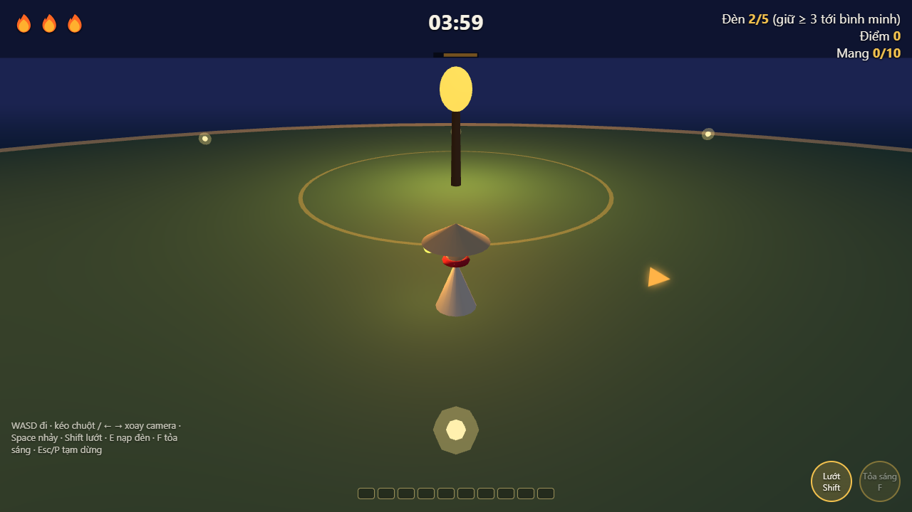
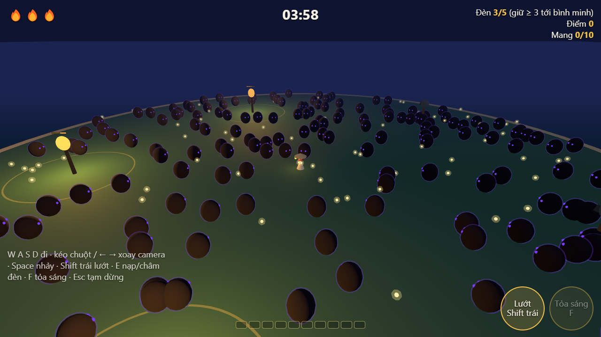

# Đảo Đèn Lồng — v1.0.0

> 🎬 **Video demo:** [demo.mp4](https://github.com/Ptuancuong/K5-L3A-DAY12-PhamTuanCuong-2A202603584-AI-SDLC-Dao-Den-Long/releases/download/v1.0.0/demo.mp4) — đính kèm ở [Release v1.0.0](https://github.com/Ptuancuong/K5-L3A-DAY12-PhamTuanCuong-2A202603584-AI-SDLC-Dao-Den-Long/releases/tag/v1.0.0) (kèm bản chạy sẵn `dao-den-long-v1.0.0.zip`)
> Bài lab cá nhân Day 12 AI SDLC — Phạm Tuấn Cường · 2A202603584. Đề bài: [docs/lab/](docs/lab/).

Game 3D góc nhìn thứ ba. Mây, người giữ đèn nhỏ tuổi đội nón lá, đi qua ba hòn đảo trong sương đen: gom đom đóm,
thắp và giữ dầu cho các Đèn Lồng Lớn, né Bóng Mực, và giữ đủ đèn sáng tới bình minh.




## Yêu cầu hệ thống

- **Node.js ≥ 18** (đã thử 20 và 24) và npm. Windows 10/11, macOS hoặc Linux.
- Trình duyệt có WebGL2: Chrome/Edge/Firefox bản mới. Card đồ họa rời hoặc tích hợp đời mới.
- Chỉ để chạy **bench**: Playwright Chromium (`npx playwright install chromium`). Nếu chưa cài, bench tự dùng Chrome hoặc Edge có sẵn trên máy.

## Cài đặt và chơi (3 lệnh)

```bash
git clone https://github.com/Ptuancuong/K5-L3A-DAY12-PhamTuanCuong-2A202603584-AI-SDLC-Dao-Den-Long.git && cd K5-L3A-DAY12-PhamTuanCuong-2A202603584-AI-SDLC-Dao-Den-Long
npm ci && npm run build
npm start          # mở http://localhost:4173 (Ctrl+C để tắt)
```

`npm start` chạy `node build/serve.mjs`: server tĩnh cho `dist/` kèm API lưu Bảng xếp hạng ra đĩa (`save/leaderboard.json`).
Bản chạy sẵn không cần build: tải `dao-den-long-v1.0.0.zip` ở Release v1.0.0, giải nén, chạy `node build/serve.mjs`.

## Điều khiển (đổi được trong Cài đặt)

| Phím mặc định   | Hành động                                                               |
| --------------- | ----------------------------------------------------------------------- |
| W A S D         | Đi (theo hướng camera)                                                  |
| Kéo chuột / ← → | Xoay camera                                                             |
| Space           | Nhảy                                                                    |
| Shift           | Lướt (14 m/s trong 0.2 s, hồi chiêu 1.5 s)                              |
| E               | Nạp ánh sáng vào đèn chưa sáng / châm dầu cho đèn đang sáng (trong 2 m) |
| F               | Tỏa Sáng: tốn 3 đom đóm, làm choáng và đẩy lùi Bóng Mực trong 5 m       |
| Esc (hoặc P)    | Tạm dừng                                                                |
| Enter / R       | Ở màn kết quả: Đêm kế tiếp / chơi lại Đêm                               |

## Luật chơi (Contract v1.2–v1.3)

| Đêm | Đảo                                  | Thời gian | Đèn (cần giữ sáng tới bình minh) | Điểm mới                              |
| --- | ------------------------------------ | --------- | -------------------------------- | ------------------------------------- |
| 1   | Đảo Bến: đảo tròn 40 m               | 240 s     | 5 (≥ 3)                          |                                       |
| 2   | Đảo Cau: hai đảo nối bằng cầu tre    | 270 s     | 6 (≥ 4)                          | Bục nhảy, Gió Lạc, Bùa Gió            |
| 3   | Đảo Chuông: 3 tầng, dốc, tháp chuông | 300 s     | 7 (≥ 5)                          | Gió mạnh mỗi 30 s, Bóng Mực nhanh hơn |

- Nhặt đom đóm khi đi qua (≤ 1 m). Sức chứa = 10 + 2 × số lần thắp thành công (tối đa 20).
- Đèn cần **10** đom đóm để thắp lần đầu, **5** để thắp lại. Đèn sáng tiêu hao **1 dầu/giây** (tối đa 100), hết dầu thì tắt.
  Bấm E ở đèn sáng để châm dầu (+10 mỗi đom đóm).
- Đèn có ≥ 30 dầu tạo vòng an toàn 6 m. Đèn dưới 30 dầu nhấp nháy, mất vòng an toàn, và Bóng Mực tới hút dầu (5/giây).
- Bóng Mực thấy Mây trong 12 m thì đuổi (4 m/s, Đêm 3: 4.5). Bị chạm: mất 1 Ngọn Lửa, rơi một nửa đom đóm, bất tử 1.5 s.
  Rơi khỏi đảo: mất 1 Ngọn Lửa và toàn bộ đom đóm. Hết 3 Ngọn Lửa thì thua.
- Gió Lạc (Đêm 2, 3) cướp 3 đom đóm. Bùa Gió: 10 s chạy nhanh, lướt không hồi chiêu.
- **Điểm:** +5 mỗi đom đóm nạp/châm, +100 thắp lần đầu, +40 thắp lại, +5 mỗi Bóng Mực trúng Tỏa Sáng (+15 nếu nó đang hút dầu).
  Khi thắng: mỗi đèn sáng +50 + số dầu còn lại, mỗi Ngọn Lửa +50. Tổng điểm game = tổng điểm các Đêm đã thắng.
- Mọi con số nằm trong [game.contract.json](game.contract.json); code đọc trực tiếp file này. Quyết định thiết kế: [docs/adr/](docs/adr/).

## Bảng xếp hạng

Sau màn **Bình Minh** (thắng Đêm 3) hoặc khi thua ở bất kỳ Đêm nào, nhập tên (3–12 ký tự chữ, số, `_`; **có dấu tiếng Việt được**) để lưu điểm.
Lưu top 10 (điểm giảm dần, bằng điểm thì ai đạt trước đứng trên) vào `save/leaderboard.json`. Xem ở menu → **Bảng xếp hạng**.

```bash
node build/serve.mjs --export-leaderboard out.json     # run_cmd --export-leaderboard: {"entries": [...]}
```

## Dễ tiếp cận (Cài đặt, tự lưu)

- **Đổi phím** cho mọi hành động; trùng phím thì báo và không nhận; nút **Khôi phục mặc định**.
- **Phụ đề và chỉ báo hình ảnh**: Bóng Mực xuất hiện (kèm mũi tên tím ở mép màn hình), gió sắp thổi, 10 giây cuối, đèn dưới 30 dầu, đèn tắt, bị chạm.
- **Giảm chuyển động**: tắt rung camera, chớp màn hình và các hiệu ứng nhấp nháy nhanh (mặc định theo `prefers-reduced-motion` của hệ điều hành).
- **Chữ lớn ×1.25**. Mọi chữ UI ≥ 18 px ở 1280×720 ([kết quả đo](docs/proof/phase-4/font-audit.md)). **Bảng màu dễ phân biệt** cho người mù màu.

## Kiểm thử

```bash
npm test                         # typecheck + unit test + 59 scenario headless + tất định + mã lỗi CLI
npm run verify -- phase-4        # chạy mọi scenario qua CLI thật + soak + kiểm bench.json, ghi docs/proof/phase-4/
node scripts/mutation-check.mjs  # đổi từng số tuning (15 khóa), mỗi lần phải có scenario đỏ
npm run shot -- phase-4          # (cần Playwright Chromium) chụp ảnh game thật + đo cỡ chữ
```

CI (GitHub Actions, Ubuntu + macOS) chạy build, test, verify, so khớp bằng chứng đã commit, và thử đúng các lệnh trong contract.

## Headless (Test Contract)

```bash
node build/headless.mjs --seed 1 --night 1 --ticks 600 --out out.jsonl \
  [--scenario s.json] [--inputs i.json] [--snapshot-every 10]
```

Mã thoát: `0` thành công · `2` file inputs/scenario sai định dạng · `1` lỗi tham số khác.

## Benchmark (`bench_cmd`)

```bash
npm run build
node scripts/bench.mjs --seed 42 --duration 30 --out bench.json
```

Mở cửa sổ Chromium 1280×720 (không toàn màn hình), **tắt vsync** bằng `--disable-gpu-vsync --disable-frame-rate-limit`.
Cảnh chuẩn: Đêm 1, 200 Bóng Mực wander, 100 đom đóm, L1–L3 sáng đầy dầu, Mây đứng yên ở (0,0,0), camera bay vòng r 30 m, cao 15 m, 15 s/vòng.
Khởi động 3 s rồi đo đúng `--duration` giây, tự thoát với mã 0.
`peak_mem_mb` là tổng RSS của cả cây tiến trình trình duyệt. `load_ms` tính từ lúc tiến trình bench khởi động (gồm cả mở server và trình duyệt).

Kết quả trên máy tôi ([bench.json](bench.json)): RTX 3060 Laptop, i5-12500H: **avg 226 fps, 1 % low 148 fps, p95 5.9 ms, load 1.2 s, peak 444 MB**.

## Soak test (`soak_cmd`)

```bash
node --expose-gc --jitless --single-threaded --max-semi-space-size=1 build/soak.mjs --seed 7 --nights 10 --out soak.json
```

Chạy 10 Đêm liên tiếp trong một tiến trình (1 → 2 → 3 xoay vòng), Đêm thứ i dùng seed 7 + i, input ngẫu nhiên theo seed.
Kết quả ([soak.json](soak.json)): 0 crash, RSS 55.1 → 56.6 MB (≤ 1.2×). Vì sao dùng các cờ Node: [ADR 0002](docs/adr/0002-bench-soak-leaderboard.md).

## Tài liệu

- Truy vết yêu cầu → bằng chứng: [docs/proof/README.md](docs/proof/README.md) · [CHANGELOG](CHANGELOG.md) · [CREDITS](CREDITS.md) · [LICENSE](LICENSE) (MIT)
- Giả định: [docs/notes/assumptions.md](docs/notes/assumptions.md) · Nhật ký AI: [docs/notes/ai-log.md](docs/notes/ai-log.md) · **Retro**: [docs/notes/retro.md](docs/notes/retro.md)

## Harness AI

[CLAUDE.md](CLAUDE.md) · skill [.claude/skills/verify](.claude/skills/verify/SKILL.md) · subagent [.claude/agents/reviewer.md](.claude/agents/reviewer.md) ·
hook [.claude/settings.json](.claude/settings.json): Stop hook không cho agent kết thúc khi `npm test` đỏ ([scripts/hooks/stop-tests.mjs](scripts/hooks/stop-tests.mjs)).

## Sáng tạo của tôi

Chỉ ở lớp hiển thị, không đổi output headless và tắt trong cảnh benchmark:

- Đèn nhỏ trên nón lá của Mây sáng dần theo số đom đóm đang mang; ánh sáng môi trường tăng theo số đèn sáng.
- Lời thoại riêng của Ông Đăng ở màn giới thiệu từng Đêm và màn Bình Minh.
- Âm thanh và nhạc nền tổng hợp hoàn toàn bằng WebAudio (không dùng file âm thanh ngoài).
- Lá bay báo gió, rung camera nhẹ khi bị chạm (tắt được bằng Giảm chuyển động).

## Cấu trúc

```
src/core/      luật chơi thuần, tất định (game + headless + bench + soak dùng chung)
src/render/    Three.js: chỉ vẽ, đọc phím, giao diện
src/shared/    luật Bảng xếp hạng, công thức bench.json
src/server/    server tĩnh + API Bảng xếp hạng (run_cmd)
src/headless/  CLI headless và soak
tests/         unit test + tests/scenarios/<tên>/{scenario,inputs,expect}.json
scripts/       bench, verify, mutation check, screenshot, build, hook
docs/          đề bài, ADR, ghi chép, bằng chứng
```
